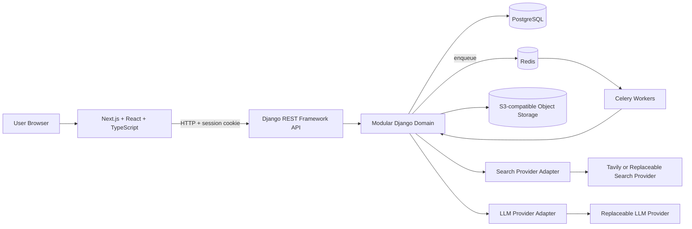
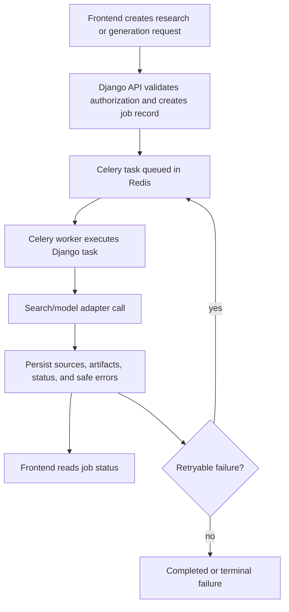
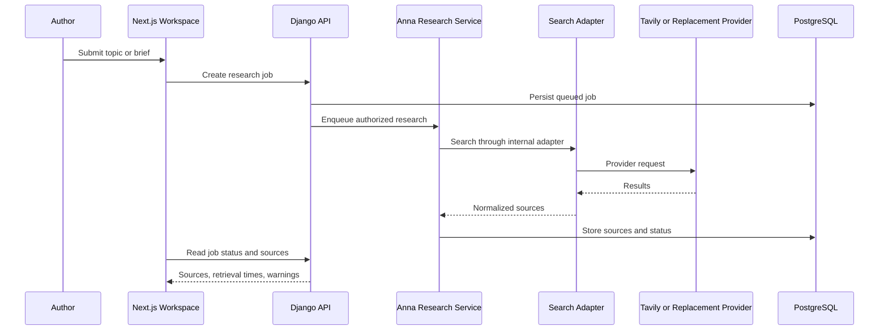
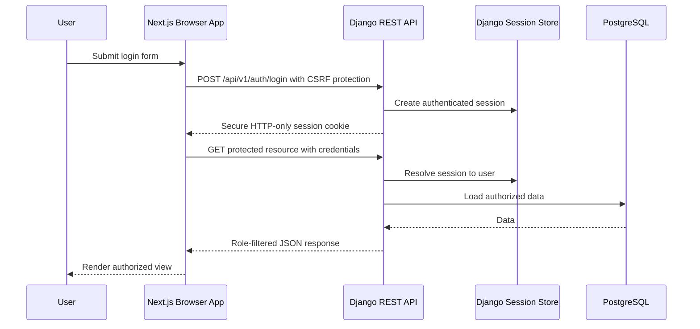
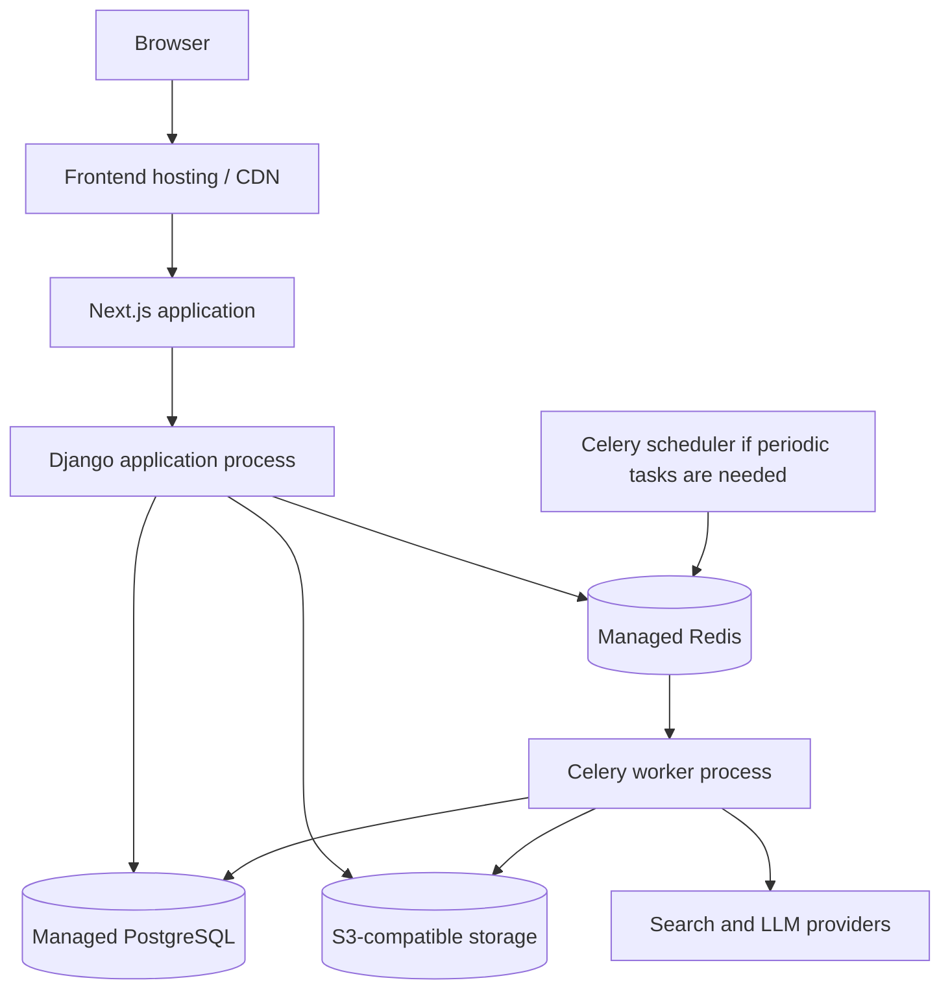

# SwiftPost — Technology Stack and Architecture

**Status:** Architecture baseline with V1 conversation delivery status  
**Product:** SwiftPost  
**Backend style:** Modular Django monolith  
**Frontend:** Next.js, React, TypeScript  
**Backend:** Django, Django REST Framework  
**Database:** PostgreSQL  
**Date:** 30 October 2026

---

> **Current delivery status:** Writer platform. Signup is `author`. Authors publish/unpublish their own posts. Composer UI is conversation + private draft + right-side images. Anna UI is one-shot review. Live research, Celery, Redis, queues, retries, and polling remain V2.


## 1. Technology strategy

SwiftPost is a production-oriented writer platform with a Next.js frontend (`source/`) and a Django REST modular monolith (`blogging-system-yt/`). One deployable Django application with clear internal modules — not microservices.

The architecture is designed to be understandable for an internship-level project while preserving production-quality boundaries:

- Django owns business rules, identity, authorization, persistence, publishing, moderation, media coordination, and Anna orchestration.
- Django REST Framework is the API boundary from version one.
- Next.js owns page composition, browser interaction, and presentation state; it does not own business rules or authorization.
- PostgreSQL owns durable application data.
- Celery and Redis are deferred to V2. V1 conversation generation is synchronous, bounded, and does not expose jobs or polling.
- S3-compatible object storage owns uploaded binary files.
- Anna remains a Django module and uses replaceable adapters for search and LLM providers.

### Confirmed decisions

- The product is single-platform and non-multi-tenant.
- Django is the only backend framework.
- Django REST Framework is required from the first version.
- PostgreSQL is the production database.
- Authentication uses Django sessions with secure HTTP-only cookies.
- Celery and Redis are a confirmed V2 architecture choice, not a V1 dependency.
- S3 or S3-compatible storage is used for uploaded files.
- Anna is an internal Django module, not a separate microservice.
- Reader-side AI is out of scope for the current version.
- Anna must not publish content automatically.
- Registration creates `author`; `admin` is not self-serve.
- Authors publish and unpublish their own complete posts; admins can unpublish any live post.
- Composer default model: `nvidia/nemotron-3-super-120b-a12b` via `AI_MODEL_COMPOSE`.
- Anna review default model: `openai/gpt-5.5` via `AI_MODEL_REVIEW`.
- Live image search uses Tavily behind `SearchProvider`.
- Frontend is Next.js in `source/`.

### Recommendations

- Keep domain behavior in service/policy modules instead of views or serializers.
- Keep provider integrations behind interfaces and adapters.
- Prefer explicit workflows and structured outputs over open-ended autonomous agents.
- Add a small number of dependable abstractions rather than introducing infrastructure for hypothetical scale.

### Open decisions

- The deployment provider and production topology.
- Exact retention limits for AI conversations and generated artifacts.
- The V2 trigger for moving generation/research off the synchronous request path.
- In-app admin user-management beyond Django admin.

## 2. High-level architecture

SwiftPost is a modular Django monolith with a separate browser frontend. The frontend communicates with Django through authenticated HTTP API requests. Local development uses SQLite and inline AI calls. Production uses PostgreSQL and S3. Redis/Celery in the diagram below are the **V2** research-job topology, not a V1 requirement.



The system is not microservices-based. Celery workers are execution processes for background tasks, not independent business services. They share the Django domain modules and configuration.

## 3. Frontend stack

### Next.js

**What it is:** A React framework for routing, page composition, server/client rendering choices, and frontend application structure.

**Why it is used:** SwiftPost needs public content pages, authenticated dashboards, an editor, and an AI workspace. Next.js provides a structured application shell for these experiences while allowing the team to choose rendering behavior per route.

**Owns:**

- Browser routes and page composition.
- Public blog presentation.
- Author and admin dashboard presentation.
- Loading, empty, and error UI states.
- Client-side interaction with the Django API.
- AI workspace layout and local interaction state.

**Must not own:**

- Authorization decisions.
- Post ownership checks.
- Publishing state transitions.
- AI provider calls or prompts containing provider-specific logic.
- Direct database access.
- Secret API keys.

**Communicates with:** Django REST Framework over authenticated HTTP requests. The browser should not call PostgreSQL, Celery, Redis, S3 credentials, Tavily, or an LLM provider directly.

### React

**What it is:** The component and interaction model used by the Next.js frontend.

**Why it is used:** React is appropriate for an editor, chat panel, conversation sidebar, source review, status indicators, and role-aware dashboard views.

**Owns:** Component rendering, form interaction, local UI state, optimistic presentation where safe, and accessible interaction patterns.

**Must not own:** Domain truth, permission enforcement, durable persistence, or final publishing decisions.

### TypeScript

**What it is:** A typed language layer for frontend JavaScript.

**Why it is used:** The application has many related resource states—drafts, jobs, sources, messages, artifacts, and publishing statuses. TypeScript reduces accidental mismatches at the API/UI boundary.

**Owns:** Frontend type definitions, API client contracts, component props, and local state models.

**Must not be treated as:** A replacement for server-side validation. The backend remains authoritative.

### Frontend structure recommendation

Organize the frontend by user-facing capability rather than by generic component type alone:

```text
frontend/
  app/ or pages/
  features/
    public-blog/
    author-dashboard/
    blog-editor/
    anna-workspace/
    admin-moderation/
  components/
  lib/
    api-client/
    auth/
    validation/
  types/
```

The exact Next.js routing convention remains an implementation decision. Business rules should remain in Django modules.

## 4. Backend stack

### Django

**What it is:** The backend web framework and application runtime.

**Why it is used:** The existing product is Django-based, and Django provides mature authentication, ORM, migrations, request handling, admin foundations, security middleware, and a clear path to a maintainable modular monolith.

**Owns:**

- Domain models and business rules.
- Authentication and session management.
- Authorization and ownership policies.
- Publishing lifecycle.
- Comments and moderation.
- Media coordination.
- Anna orchestration.
- API request handling through DRF.
- Database transactions and migrations.

**Must not own:** Frontend presentation details, provider-specific logic scattered through views, or background execution logic that bypasses domain services.

### Modular Django applications

Recommended modules:

| Module | Responsibility | Must not own |
|---|---|---|
| `accounts` | Login, logout, registration, session-facing identity behavior | Post publishing rules |
| `users` / `roles` | Role and permission policy, account state, user administration | UI-only role hiding |
| `blogs` | Post, draft, slug, category relationship, content read/write behavior | LLM calls or provider credentials |
| `categories` | Category lifecycle, visibility, organization | User authorization decisions outside category policy |
| `comments` | Comment creation, status, moderation-facing operations | Post publishing transitions |
| `publishing` | Draft/submission/publication state transitions and history | Rendering pages or AI prompts |
| `moderation` | Admin review, flags, decisions, audit events | General author editing |
| `media` | Upload validation, storage coordination, asset lifecycle | Storing binary files in PostgreSQL |
| `anna` | Conversations, messages, context, research, generation, provenance | Direct frontend access to providers |
| `common` | Shared errors, IDs, time utilities, base policies, observability helpers | Becoming an unbounded catch-all |

Modules should expose small interfaces and hide internal complexity. A view or API endpoint should orchestrate a use case, not reimplement domain rules.

## 5. Django REST Framework API layer

Django REST Framework is part of the first version, not a later migration step.

DRF owns:

- Serialization and validation of API input/output.
- Authentication integration with Django sessions.
- Permission classes and object-level authorization hooks.
- Resource-oriented endpoint behavior.
- Pagination, filtering, and safe error responses.
- API schema/documentation generation if selected.

DRF must not become a second place where business rules are invented. Serializers validate transport input; domain services enforce business behavior and transactions.

### API principles

- Every protected resource requires authentication.
- Every author-owned resource performs an object-level ownership check.
- Admin access is explicit and policy-based.
- Mutations validate state transitions server-side.
- Long-running AI work returns a persisted job/request representation rather than holding an unbounded request open.
- Errors are safe, structured, and free of provider keys or internal stack traces.
- API responses expose only fields appropriate to the current role.
- API versioning should be chosen before public release; a simple `/api/v1/` prefix is recommended.

## 6. Authentication and authorization

### Authentication model

SwiftPost will use Django authentication with secure HTTP-only session cookies.

1. The user submits login credentials to a Django authentication endpoint.
2. Django validates the credentials against the configured user store.
3. Django creates a server-side session and sends a session cookie to the browser.
4. The browser automatically sends the cookie on eligible requests to the Django API.
5. Django loads the authenticated user from the session for each request.
6. Logout invalidates the session server-side and clears the browser cookie.

The frontend does not receive or store a reusable JWT for this architecture. The session cookie should use `Secure` in production, `HttpOnly`, an intentional `SameSite` policy, an appropriate domain/path, and a bounded lifetime.

### Frontend/API communication

The Next.js frontend calls Django API endpoints with credentials included according to the deployment topology. The local `/api` rewrite uses `experimental.proxyTimeout` of five minutes so Composer and Anna LLM calls are not cut off at the default 30 seconds. If frontend and backend use different origins, Django CORS and CSRF settings must be configured explicitly; permissive wildcard settings are not acceptable for authenticated production traffic.

Cookie-based unsafe requests must include the CSRF token expected by Django. The frontend API client should centralize credential inclusion, CSRF handling, response normalization, and authentication-expiry behavior. Each tab may send `X-Session-Key` from `sessionStorage`; that header wins over the shared session cookie so one tab's login or logout does not take over another tab.

### Sessions versus JWT

| Concern | Django session cookie | JWT |
|---|---|---|
| Session state | Stored/validated server-side | Token carries claims client-side |
| Revocation | Straightforward server-side invalidation | Requires expiry, denylist, rotation, or issuer strategy |
| Browser storage | HTTP-only cookie | Often incorrectly placed in local storage |
| CSRF | Must be handled for cookie requests | Different threat model; still requires careful storage/CORS design |
| SwiftPost choice | Selected | Not selected for the initial architecture |

JWT is not required just because the frontend is Next.js. The selected session model is simpler for this single-platform application and keeps identity state under Django control.

### Authorization and ownership

Authentication answers “who is this?” Authorization answers “what may this user do to this object now?”

- Readers can access public content and permitted comment operations.
- Authors can access their own eligible drafts/posts and author tools.
- Admins can access platform-management and moderation capabilities within explicit admin policy.
- An author cannot use a post ID, draft ID, conversation ID, or research ID to access another user's private data.
- UI visibility is not security. Every API and domain mutation repeats the authorization check.
- Email address is not an authorization identity; use the authenticated user/account identity and object ownership relationships.

## 7. Database and data persistence

### PostgreSQL

**What it is:** The production relational database.

**Why it is used:** SwiftPost has relational ownership, roles, lifecycle states, comments, moderation history, conversations, jobs, and sources. PostgreSQL provides durable transactions, constraints, indexing, and reliable production behavior.

**Owns:** All durable application records, relationships, statuses, audit references, and migration-managed schema.

**Must not own:** Large binary media files, transient queue messages, raw provider secrets, or unbounded temporary logs.

SQLite may be used only for limited local experimentation if the application remains compatible, but it is not part of the production architecture.

### Core persistence concepts

- User, role, and permission records.
- Categories.
- Posts and drafts.
- Post status and publishing history.
- Comments and moderation records.
- Media metadata and object-storage keys.
- AI conversations and chat messages.
- Selected post/draft context.
- Research jobs and source records.
- Generated titles, outlines, drafts, and revision artifacts.
- AI generation runs, statuses, errors, retries, and safe usage metadata.
- Author approval/provenance records.

### Persistence rules

- Use migrations for schema changes.
- Use foreign keys and database constraints for relationships that must be consistent.
- Use transactions for publishing, ownership-sensitive mutations, and approval transitions.
- Index common access paths: owner, status, slug, category, timestamps, conversation, job status, and source relationships.
- Keep generated AI artifacts distinguishable from final author-approved post content.
- Define archival/deletion and retention behavior before production launch.

## 8. Background jobs and queues (V2; not part of the current V1 conversation-history slice)

### Celery

**What it is:** The background-task execution system.

**Why it is used:** Live research and generation may take longer than a normal HTTP request and need retries, status tracking, and failure isolation.

**Owns:** Executing queued tasks such as research, source processing, generation, and retryable improvements.

**Must not own:** The source of truth for durable task status or business authorization. Those remain in Django/PostgreSQL.

### Redis

**What it is:** The queue broker and temporary coordination store for Celery.

**Why it is used:** Redis provides a practical broker for the initial modular monolith deployment.

**Owns:** Transport and short-lived task coordination.

**Must not own:** Canonical post content, final publishing state, user identity, or irreplaceable AI history.

### Job lifecycle

Use explicit persisted states such as `queued`, `running`, `succeeded`, `failed`, `retrying`, and `cancelled` where supported. The API should expose job status so the frontend can show progress without assuming a task succeeded merely because it was queued.



Tasks must be idempotent or use request/job identifiers to avoid duplicating artifacts on retries.

## 9. File and media storage

### S3 or S3-compatible object storage

**What it is:** Durable object storage for binary files.

**Why it is used:** Featured images, author uploads, and future attachments should not consume PostgreSQL storage or application disk.

**Owns:** Binary object bytes, storage keys, content-type metadata, and object lifecycle according to configured policy.

**Must not own:** Publishing permissions, post content, or the only copy of critical metadata.

PostgreSQL stores the media asset metadata and the object key. The backend validates upload authorization and type/size rules before accepting an object. The browser must not receive broad storage credentials.

### Media safeguards

- Validate MIME type, extension, size, and content where practical.
- Generate server-controlled object keys.
- Prevent executable content from being served as application code.
- Use private objects plus controlled delivery where content is not public.
- Define replacement, orphan cleanup, and deletion behavior.
- Avoid storing large files directly in PostgreSQL.

## 10. Author AI architecture

### Composer (V1, live)

Composer is a separate Django module from Anna. The author starts a conversation with a title or brief. Composer calls the shared LLM adapter (`AI_MODEL_COMPOSE` / Nemotron), writes or refines a complete private draft, and stores provenance. After a draft exists it may request Tavily image suggestions. It does not publish. The author opens the draft in the editor or Stories and publishes themselves.

## 10.1 Anna AI architecture

### V1 (live UI)

Anna's browser UI is **one-shot review**: `POST /api/v1/ai/reviews/` with an owned `post_id`. Notes come back. Status stays `draft`. Do not add a chat sidebar unless the user asks.

### V2 (not built)

Live web research, source collection, Celery jobs, retries, and polling are deferred. Django may still have Anna conversation tables from an earlier slice; those are not the current product UI.

### Anna must not

- Publish automatically.
- Bypass normal post authorization or moderation.
- Access another author's private draft.
- Call providers directly from frontend code.
- Treat retrieved web text as trusted instructions.
- Replace final author review with a model confidence score.

### Current author AI workspace

- **Composer:** conversation list + chat + private draft + right-side images.
- **Editor:** save, publish, unpublish.
- **Anna:** one-shot review with a loading pipeline.
- **Stories:** all of the author's drafts and posts.

## 11. LangChain usage

LangChain is used inside the Anna module for:

- `ChatPromptTemplate` for Composer and Anna review prompts.
- `ChatOpenAI` against the configured OpenAI-compatible base URL.
- `JsonOutputParser` to normalize Composer article JSON.

LangChain must remain behind Anna's internal interfaces. Domain modules such as `blogs`, `publishing`, and `moderation` should not import provider-specific chains directly. Tavily stays behind `SearchProvider`; LangChain does not call Tavily by itself.

Do not introduce LangGraph, vector databases, or complex multi-agent architecture without a concrete product requirement. The first version should be understandable as a sequence of controlled use cases:

```text
Use case → Anna service → provider adapter/tool → validated result → persisted artifact
```

If LangChain is not needed for a particular operation, a direct provider adapter is acceptable. The technology is optional; the boundary and behavior are required.

## 12. Live web research and Tavily integration

**V1:** Tavily is used for **live featured-image search** after a Composer draft exists (`SearchProvider`). That is not Anna research.

**V2:** Anna live-web research, persisted research jobs, and source collections are not built. The research sequence below is the target for V2 only. Do not implement it unless asked.

### Search-provider adapter

Tavily or another approved provider may supply live web research. It must be hidden behind an internal interface such as a research/search adapter so provider-specific request formats do not spread through Anna or the rest of Django.

The adapter owns:

- Provider request/response translation.
- Search limits and timeout handling.
- Source normalization.
- Provider-specific error mapping.
- Safe metadata extraction.

The adapter must not own author permissions, post publishing, or final source approval.

### Research behavior

The system should:

- Record the research request and job status.
- Store source URL, title, provider reference, retrieval time, and relevant metadata.
- Present sources to the author before final approval.
- Surface conflicting, low-quality, inaccessible, or incomplete sources where detectable.
- Avoid invented citations.
- Treat source text as untrusted data and defend against prompt injection.
- Keep provider credentials server-side.
- Apply timeouts, retry limits, quotas, and cost controls.



## 13. LLM provider abstraction

The LLM provider must be replaceable through an internal interface. Anna should depend on an application-level capability such as `generate_titles`, `generate_outline`, `generate_draft`, or `revise_content`, not on a vendor SDK scattered across domain code.

The provider adapter owns:

- Provider authentication.
- Request formatting.
- Model selection.
- Timeout and retry translation.
- Usage/cost metadata normalization.
- Provider error mapping.

Anna owns:

- Context assembly.
- Authorization.
- Prompt/input policy.
- Expected structured output schema.
- Artifact persistence.
- Human-review and approval rules.

The frontend must never call the LLM provider directly. Provider responses must be validated before they become generated artifacts.

## 14. API design and endpoint groups

Live groups (see `docs/BACKEND_STATUS.md` for the contract):

```text
/api/v1/auth/
/api/v1/blogs/
/api/v1/drafts/
/api/v1/categories/
/api/v1/comments/
/api/v1/media/
POST /api/v1/blogs/{id}/publish|unpublish|submit|archive/
/api/v1/ai/compose/
/api/v1/ai/composer/conversations/
POST /api/v1/ai/reviews/
/api/v1/ai/anna/conversations/   # exists; current UI uses /reviews/
GET /api/v1/health/
```

Do not add `/api/v1/ai/jobs/` or Anna research-job polling in V1.

### Endpoint responsibilities

- **Authentication:** login, logout, registration, current user/session state, CSRF.
- **Posts/drafts:** list, retrieve, create, update, archive according to policy.
- **Categories:** public reads and admin mutations.
- **Comments:** create, list approved comments; post author or admin can approve.
- **Likes:** toggle a like on a published post.
- **Media:** upload, Tavily live-image suggestions, multi-select save.
- **Publishing:** owning author or admin publish/unpublish; archive from non-published.
- **Composer conversations:** create, list, continue, archive. Writes a private draft.
- **Anna review:** one-shot notes on an owned draft.

The API must return safe, consistent validation and authorization errors. It must never allow an AI endpoint to directly transition a post to public state.

## 15. Frontend-backend communication



The frontend API client should centralize:

- Base URL and environment configuration.
- Credential inclusion.
- CSRF token handling.
- JSON/error parsing.
- Authentication expiry behavior.
- Request correlation headers where supported.
- Job polling or status refresh behavior.

The frontend may optimistically update local UI for low-risk interactions, but the server response remains authoritative for content, permission, status, and publishing state.

## 16. Deployment architecture

The deployment topology should keep the frontend and backend as separate application processes while remaining operationally simple.



This diagram describes responsibilities, not a mandated vendor. Do not invent additional infrastructure until deployment requirements are known.

### Deployment responsibilities

- Frontend hosting serves the Next.js application.
- Django runs the API and domain logic.
- Celery workers run long-running/retryable AI and research tasks.
- Redis brokers tasks and holds temporary coordination state.
- PostgreSQL stores durable state.
- S3-compatible storage stores binary media.
- External providers are reached only by server-side adapters.

Production deployment must include migrations, secure environment configuration, health checks, logs, backups, and a rollback plan.

## 17. Testing strategy

### Backend tests

- Model constraints and relationships.
- Authentication and session behavior.
- Role and object-level authorization.
- Cross-author access rejection.
- Post lifecycle transitions.
- Publishing and moderation history.
- Comment moderation.
- Upload validation and storage coordination.
- DRF serializer and endpoint behavior.
- Anna context authorization.
- Conversation/message persistence.
- Research and generation status transitions.
- Provider adapter error mapping.
- Retry/idempotency behavior.

### Frontend tests

- Public discovery and search states.
- Login/session-expiry behavior.
- Role-aware navigation.
- Author draft and editor flows.
- AI conversation create/resume behavior.
- Context selection UI and authorization-safe errors.
- Source review and generated-artifact states.
- Loading, empty, timeout, retry, and failure states.

### Integration and browser verification

Verify the complete paths in a running environment:

- Register/login/logout.
- Public browse/search/category/detail.
- Author create/save/edit/submit.
- Cross-author direct API rejection.
- Admin moderation and publishing.
- Comment lifecycle.
- Media upload.
- Start/resume AI conversation.
- Research job and source display.
- Draft/post context selection.
- Generation failure and retry.
- Explicit approval followed by normal save/publish.

Tests must not claim successful AI factuality. They should verify provenance, source visibility, authorization, failure handling, and workflow state.

## 18. Monitoring and observability

The system should emit structured logs and metrics for:

- Request method, route, status, duration, and correlation ID.
- Authentication failures and authorization denials without exposing credentials.
- Publishing and moderation actions.
- Media validation/storage failures.
- AI conversation, research, generation, retry, timeout, cancellation, and provider-error events.
- Job queue depth, task duration, task failure, and retry counts.
- Search/provider latency and usage/cost metadata where available.
- Database and application health.

Do not log passwords, session secrets, provider keys, full sensitive prompts, private drafts, or unnecessary raw source content. Retention and redaction rules must be defined with the deployment configuration.

## 19. Security requirements

- Use Django's password hashing and authentication protections.
- Use secure HTTP-only session cookies in production.
- Configure CSRF protection for cookie-authenticated unsafe requests.
- Configure CORS narrowly when frontend/backend origins differ.
- Enforce authorization at API and domain boundaries.
- Check ownership on every post, draft, conversation, message, source, job, and artifact access.
- Validate all request data server-side.
- Sanitize or safely render rich content and AI output.
- Rate-limit login, comments, media, and AI requests appropriately.
- Keep provider keys and storage credentials server-side.
- Protect server-side URL fetching against SSRF and unsafe redirects.
- Treat external webpage content as untrusted data and defend against prompt injection.
- Use safe upload names, MIME/type checks, size limits, and object-storage policies.
- Do not expose internal exceptions or provider responses directly to users.
- Audit important publishing, moderation, approval, and permission changes.

## 20. Environment variables and secret management

Secrets must be injected through the deployment environment or an approved secret manager. They must not be committed to source control, embedded in frontend bundles, or placed in documentation with real values.

Recommended configuration categories:

```text
DJANGO_SECRET_KEY
DJANGO_DEBUG
DJANGO_ALLOWED_HOSTS
DJANGO_CSRF_TRUSTED_ORIGINS
DJANGO_CORS_ALLOWED_ORIGINS
DATABASE_URL
REDIS_URL
CELERY_BROKER_URL
AWS_ACCESS_KEY_ID
AWS_SECRET_ACCESS_KEY
AWS_REGION
AWS_S3_BUCKET
AWS_S3_ENDPOINT_URL
AI_PROVIDER
AI_MODEL
AI_MODEL_COMPOSE
AI_MODEL_REVIEW
AI_PROVIDER_API_KEY
SEARCH_PROVIDER
TAVILY_API_KEY
NEXT_PUBLIC_API_BASE_URL
```

Only variables intended for browser exposure may use the `NEXT_PUBLIC_` prefix. Provider secrets must remain backend-only. The exact names may be adjusted to match deployment tooling.

## 21. Performance and scalability

Initial performance priorities:

- Keep public blog reads fast with appropriate database indexes and bounded pagination.
- Avoid N+1 queries in post, category, author, and comment views.
- Keep AI work out of synchronous request paths when it may exceed normal latency.
- Use job status polling or a later approved update mechanism for long-running work.
- Bound research result counts, source sizes, prompt sizes, retries, and generation lengths.
- Cache only data that is safe to cache and whose invalidation behavior is understood.
- Store binary media outside PostgreSQL.
- Keep provider adapters replaceable so workload and cost can be evaluated.

The architecture can scale the Next.js process, Django process, Celery workers, Redis, database, and object storage independently as needed. This does not require splitting the Django domain into microservices.

## 22. Explicit non-goals

- Flask or a Flask sidecar service.
- A microservices architecture.
- Multi-tenant organizations or customer workspaces.
- Reader-side AI or reader chat.
- Autonomous publishing.
- AI output without human review.
- Direct frontend-to-LLM or frontend-to-search-provider calls.
- Business logic inside React components.
- Provider-specific AI logic scattered across Django modules.
- A vector database without a concrete retrieval requirement.
- LangGraph or complex agent architecture without a concrete requirement.
- Large-file storage directly inside PostgreSQL.
- Infrastructure not required by the current product or deployment plan.

## 23. Open technology decisions

**Settled:** Next.js App Router in `source/`; shadcn/ui; session cookies + CSRF with a local `/api` rewrite; SQLite locally; Composer Nemotron + Anna GPT-5.5 via AICredits; Tavily for images; LangChain behind the LLM adapter only.

Still open:

1. Frontend hosting and backend deployment provider.
2. PostgreSQL hosting, backup, and SQLite-to-Postgres cutover.
3. Redis/Celery worker model when V2 research jobs start.
4. S3-compatible storage provider and production media delivery.
5. Retention policy for conversations, prompts, and artifacts.
6. Uptime, backup/restore, and observability targets.

## 24. Recommended initial stack summary

| Area | Initial choice | Responsibility |
|---|---|---|
| Frontend framework | Next.js | Routes, rendering, and frontend application structure |
| UI runtime | React | Components and browser interactions |
| Frontend language | TypeScript | Typed API/UI contracts and component code |
| Backend framework | Django | Domain logic, authentication, authorization, persistence, and orchestration |
| API | Django REST Framework | Versioned HTTP API, serialization, validation, and API permissions |
| Authentication | Django sessions + secure HTTP-only cookies | Browser identity and session lifecycle |
| Database | SQLite locally; PostgreSQL in production | Durable relational application data |
| Background jobs | Inline in V1; Celery/Redis in V2 | Long-running research later |
| File storage | Local in dev; S3 in production | Featured images and uploads |
| AI module | Composer inside Django | Conversation drafts + Tavily images; never publishes |
| AI module | Anna inside Django | One-shot draft review in V1; live research is V2 |
| AI framework | LangChain behind adapters | Prompts and ChatOpenAI only |
| Image search | Tavily `SearchProvider` | Live featured-image suggestions |
| LLM access | AICredits OpenAI-compatible adapter | Composer Nemotron, Anna GPT-5.5 |

This stack is the implementation baseline for the SwiftPost rebuild. It is intentionally a modular monolith with explicit boundaries: simple enough to understand, structured enough to test, and replaceable where external providers may change.

